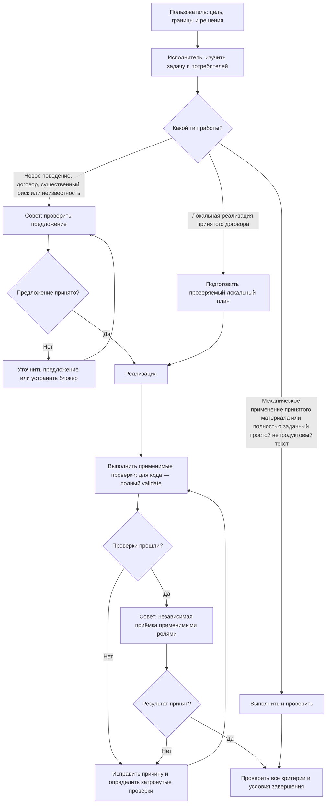
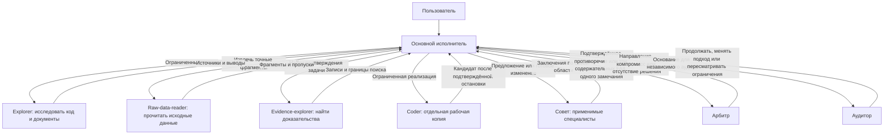
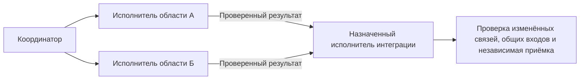
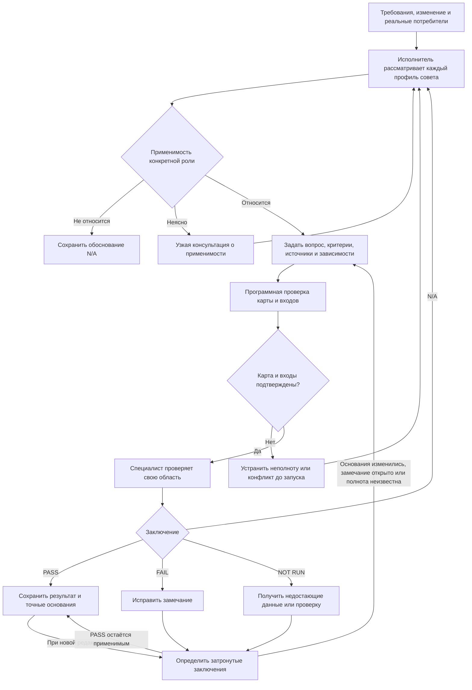

# Схемы работы agent-workflow

Схемы поясняют действующий процесс явно подключённой задачи. Они не заменяют
[каталог процедур](procedures/README.md), [договор текущего чата](CURRENT-CHAT.md)
и [правила применимости совета](docs/quality/agent-workflow-contracts.md#применимость-совета).
Предложенные, но не принятые изменения процесса здесь не показаны.

Это обзор действий и ответственности, а не полная машина технических состояний.
LOAD, владение, полномочия и подтверждения операций проверяются по соответствующим процедурам.

## Термины и участники

«Источник запуска» указывает инициатора поручения; «причина запуска» — предметное основание.
Они не заменяют проверку разрешения и технического допуска перед действием.

| Название                                          | Кто это                                                                                                                    | Что делает                                                                                                                                                         | Источник запуска                                                                                                    | Причина запуска                                                                                                                                                     |
| ------------------------------------------------- | -------------------------------------------------------------------------------------------------------------------------- | ------------------------------------------------------------------------------------------------------------------------------------------------------------------ | ------------------------------------------------------------------------------------------------------------------- | ------------------------------------------------------------------------------------------------------------------------------------------------------------------- |
| Основной исполнитель (`executor`)                 | Агент, ведущий задачу; в режиме текущего чата — агент чата, которому пользователь явно поручил задачу через agent-workflow | Разбирает требования, готовит план, реализует изменения, запускает проверки и совет, интегрирует результаты помощников; не заменяет независимую приёмку            | Пользователь явно поручает задачу; при разделении работы — уполномоченный координатор выдаёт ограниченное поручение | Нужно выполнить задачу или продолжить её до согласованного результата                                                                                               |
| Координатор (`orchestrator`)                      | Агент, которому явно поручена координация нескольких исполнителей                                                          | Распределяет разрешённые области работы и зависимости, наблюдает выполнение и собирает результаты; роль сама по себе не даёт прав реализации и технической приёмки | Пользователь явно разрешает режим координации                                                                       | Нужно распределить работу между исполнителями и согласовать зависимости и области записи                                                                            |
| Советники (`council-adviser`)                     | Отдельные независимые сеансы агентов с выбранными предметными профилями                                                    | Только на чтение проверяют предложение или фактический результат и возвращают заключения в пределах своей области                                                  | Основной исполнитель через штатный механизм совета                                                                  | Применимый профиль требует проверки предложения или результата; изменились существенные входы, нужно закрыть замечание либо уточнить применимость                   |
| Разработчик (`coder`)                             | Дочерний агент исполнителя в отдельной рабочей копии                                                                       | Выполняет ограниченную реализацию и разрешённые проверки; не меняет основное дерево, не делегирует и не принимает собственную работу                               | Основной исполнитель в рамках разрешённого делегирования по B2                                                      | Есть ограниченная часть реализации с определёнными путями, зависимостями и критерием результата                                                                     |
| Исследователь (`explorer`)                        | Помощник для конкретного вопроса по коду или документам                                                                    | Находит источники, владельцев правил и потребителей; возвращает выводы и границы исследования без изменения файлов                                                 | Исполнитель или координатор с правом такого делегирования                                                           | Нужен ограниченный поиск по конкретному вопросу, который обосновывает отдельного помощника                                                                          |
| Читатель исходных данных (`raw-data-reader`)      | Помощник для чтения заданных источников и диапазонов                                                                       | Извлекает точные фрагменты без пересказа, отмечает пропуски и полноту выборки                                                                                      | Исполнитель или координатор с правом такого делегирования                                                           | Нужна отдельная выборка исходных фрагментов по заданным диапазонам и правилам отбора                                                                                |
| Исследователь доказательств (`evidence-explorer`) | Помощник для поиска подтверждений в пределах конкретной задачи и бюджета                                                   | Находит подходящие записи, их версии и источники; чтение уже известной записи не требует такого делегирования                                                      | Исполнитель или координатор с правом такого делегирования                                                           | Нужно найти подтверждения по вопросу и явному task_id; известную запись читает сам вызывающий                                                                       |
| Арбитр (`arbiter`)                                | Независимый агент для подтверждённого противоречия или трёх последовательных содержательных FAIL одного замечания          | Предлагает направление решения, компромисс или фиксирует отсутствие решения; не реализует исправление и не закрывает замечание                                     | Основной исполнитель через процедуру арбитража                                                                      | Применимая роль подтвердила противоречие либо одно замечание получило три последовательных содержательных FAIL                                                      |
| Аудитор (`auditor`)                               | Независимый агент, оценивающий продвижение к исходной цели                                                                 | По карточке и доказательствам рекомендует продолжать, менять подход или исполнителя либо пересматривать ограничения; не исправляет код                             | Контроллер процесса организует независимый запуск по процедуре аудита                                               | Достигнут порог 2× исходной оценки, подтверждено отсутствие прогресса либо возник конкретный новый риск; уже обработанное основание не запускает немедленный повтор |
| Исполнитель интеграции                            | Назначенный executor с ответственностью за объединение результатов; не отдельный технический тип роли                      | Проверяет изменённые связи и общие входы, объединяет результаты и передаёт их на независимую приёмку                                                               | Ответственность закрепляется в разрешённом плане координации; результат coder интегрирует его основной исполнитель  | Нужно объединить результаты и проверить их взаимодействие и общий результат                                                                                         |

Совет запускает основной исполнитель: определяет применимые роли, готовит области проверки
и вызывает штатную команду agent-workflow. Программный механизм создаёт или продолжает
отдельные сеансы советников, проверяет их права, передаёт материалы и собирает ответы.
Исполнитель устраняет замечания и проверяет условия допуска; обязательный FAIL нельзя
самостоятельно заменить на PASS.

Координатор нужен только при явно разрешённой координации нескольких исполнителей.
Для обычной задачи он не обязателен: основной исполнитель может реализовать её сам
или поручить ограниченную часть coder по договору B2. Обсуждение инструмента само по себе
не подключает задачу к процессу и не запускает совет.

## Путь задачи

[Локальный план по B1](CURRENT-CHAT.md#локальная-реализация-по-b1) позволяет пропустить
предварительный совет только в пределах принятого договора; независимая приёмка остаётся.
Размер правки не определяет риск. Новые требования или выход за согласованную область
возвращают работу к planning до зависимой реализации. Неизвестная применимость роли
разрешается узкой консультацией, как показано в схеме выбора совета ниже.
Устранение блокера не означает автоматического повторного запуска операции с неизвестным исходом.

## Роли и результаты

Стрелки показывают поручения и результаты, а не обязательный запуск всех ролей.
[Исследователи](procedures/data-roles.md), [советники](roles/README.md),
[арбитр](procedures/arbitration.md) и [аудитор](procedures/audit.md) работают только на чтение.
Арбитр не закрывает замечание самостоятельно; необходимые решения пользователя сохраняются.
Содержательное поручение аудитору содержит только ссылку на карточку.

[Coder](CODER.md) пишет только в разрешённой области отдельной копии, не делегирует
и не принимает собственную работу. Основной исполнитель проверяет остановку, исходные входы
и результат, выполняет интеграцию и общие проверки. Наличие роли в каталоге не даёт разрешения
на её запуск; полномочия определяются поручением и действующим договором.

## Координация нескольких исполнителей

[Координатор](procedures/coordination.md) распределяет разрешённые поручения и зависимости.
Его полномочия не заменяют права реализации или технической приёмки. Области дочерней записи
не пересекаются. Исполнитель интеграции — ответственность назначенного executor, а не отдельный
технический тип роли. Ограниченное поручение coder допускается без отдельного координатора
по действующему договору B2.

## Выбор совета и повторная приёмка

Условия привлечения каждого специалиста принадлежат
[таблице применимости](docs/quality/agent-workflow-contracts.md#применимость-совета),
содержание экспертизы — [профилям ролей](roles/README.md), а формат требований и входов —
[договору текущего чата](CURRENT-CHAT.md#карта-применимости-совета).
На приёмке состав определяется заново по фактическому изменению.

Программа проверяет состав карты, доступность и версии источников, покрытие заявленных
объектов и допустимость использования прежних заключений. Смысловую полноту — правильно ли
выбраны специалисты и учтены потребители — определяют исполнитель и независимые проверяющие.
Область роли включает её вопрос, критерии и существенные зависимости, а не только список файлов.

При [повторе](procedures/council.md) неизменный применимый PASS сохраняет исходное подтверждение.
Изменение существенных входов требует новой проверки затронутой роли; изменение общей области
возвращает все выбранные роли. Открытый FAIL нельзя закрыть исключением специалиста из состава.
PASS одной роли и завершённый сбор ответов не означают готовности всей задачи.
