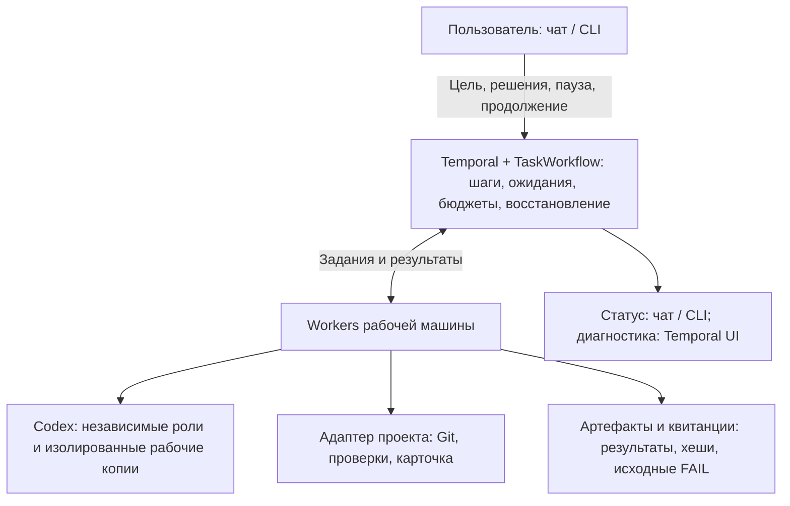
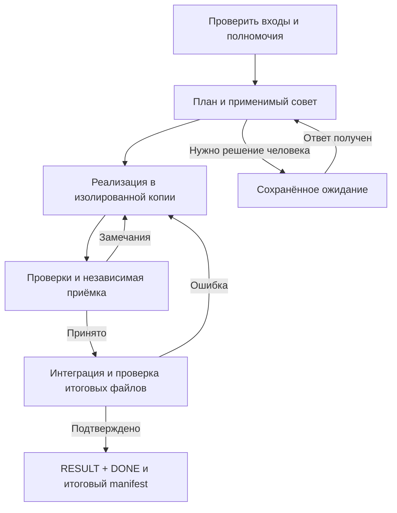

# Agent-workflow: целевая схема после миграции на Temporal

Каноническое описание перенесено в репозиторий agent-workflow 2026-11-16. Это целевой
контур, а не утверждение о завершённой квалификации или включённом T6. Перенос документов
не требует поддержки прежнего runtime; исходные evidence сохраняют собственный scope.

Чат задаёт цель и принимает решения, Temporal сохраняет ход задачи, Workers выполняют
работу через Codex и инструменты проекта. При разрешённой фоновой работе закрытие чата
не прерывает процесс.

## Путь задачи

## Основные гарантии

- Temporal заменяет собственный движок очередей, таймеров, сохранения хода и технического
  восстановления. Сценарий и правила разработки остаются нашим кодом.
- Workers запускают Codex, Git и проверки. Неизвестный исход внешнего действия сначала
  сверяется; повторная запись защищена от дублирования. Остановка внешнего writer
  подтверждается отдельно от отмены Workflow.
- Неизменные принятые результаты переиспользуются; повторяются затронутые проверки и роли.
  Обязательный `validate` сохраняется. Модель не вызывается для опроса статуса.
- Самостоятельный пакет подключается к репозиторию через версионированный descriptor
  и адаптер. Игра — первый потребитель.
- DONE фиксирует результат. Архивирование и очистка выполняются отдельно, по своим разрешениям.
- После квалификации и отдельного включения Temporal получает только новые задачи.
  Исполнение старых задач автоматически не переносится. Их исходные доказательства
  сохраняются; условия рабочего включения и очистки принадлежат актуальному плану и ADR.

Это целевое состояние, а не подтверждение готовности текущей реализации.
Схемы сокращены; полные условия и актуальные доказательства находятся в источниках:

- [План миграции](../exec-plans/active/2026-11-23-temporal-production-rollout.md).
- [Договор процесса и внешних действий](temporal-workflow.md), [данные и подключение](temporal-data-and-projects.md).
- [Выделение репозитория и актуальные границы ADR-0072](decisions/0072-extract-agent-workflow-repository.md).
