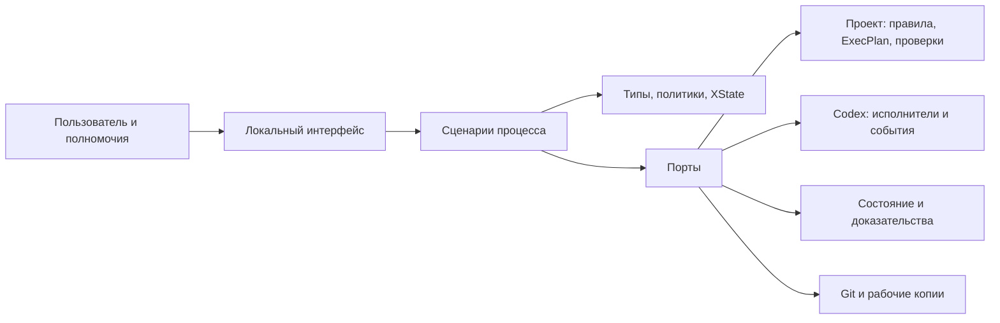

# ADR-0047: разместить полный процесс агентов в tools/agent-workflow с отделяемыми границами

- **Status:** `accepted`
- **Date:** `2026-10-15`
- **Owner:** инструменты разработки и обвязка агентов
- **Decision basis:** [явное принятие пользователем 2026-10-15](../../exec-plans/completed/2026-10-15-agent-workflow-full-implementation.md#принятие-aw0b-и-разрешение-aw1),
  [текстовый снимок предоставленной схемы v2](../../quality/agent-workflow-v2-source.md),
  [пакет для принятия AW0b](../../quality/agent-workflow-transfer-matrix.md)

## Проблема

Схема v2 задаёт восемь ветвей: основной путь, механическую работу, проблемы и арбитраж,
доказательства, передачу после сжатия контекста, ролевых помощников, координацию чатов и аудит.
Для полного внедрения недостаточно инструкций: нужны сохраняемое состояние, проверяемые
переходы, владение работой, восстановление и подтверждённое подключение к исполнителям.

В проекте уже есть маршруты AGENTS.md, ExecPlan, три профильных навыка и обязательные проверки.
Отдельных tools/agent-workflow, профилей .codex, карточек tasks и Evidence Store сейчас нет.
Перенос без границ создаст второй источник правил и состояния; преждевременное выделение
универсальной платформы потребует поддерживать договоры без второго реального потребителя.

Нужно полностью реализовать поведение схемы для текущего проекта и сохранить возможность
перенести инструмент в самостоятельный проект без переноса игровой логики и данных.

## Факторы и ограничения

- Первоначальное поручение разрешало подготовить документы. Пользователь явно принял
  архитектуру и поручил AW1; основание записано в метаданных. Запуск следующих этапов,
  изменение среды, модельные пробы, публикация и очистка требуют своих полномочий.
- Полнота означает все 53 узла, 45 портов составных модулей, 73 нарисованных перехода и
  ненарисованные вызовы/возвраты из условий; пропуск ветви нельзя назвать полным внедрением.
- Ссылочные регламенты исходной схемы отсутствуют. Их получение либо явно принятая местная
  спецификация являются входным условием соответствующего этапа, а не поводом выдумывать совместимость.
- Правила продукта, источники требований, команды и условия допуска принадлежат текущему проекту.
  Новая система не ослабляет проверки, покрытие, совместимость и полномочия.
- Сложные жизненные циклы используют XState v5; одношаговые правила — чистые функции.
  Технологическая основа — TypeScript и Node.js в поддерживаемой проектом версии.
- Текущие настройки TypeScript, ESLint, Vitest/покрытия и команда lint:arch не включают tools.
  Подключение всех проверок обязательно до приёмки исполняемого инструмента.
- Одна общая платформа извлекается после второго реального потребителя. Доказательство
  переносимости в нейтральной временной директории не считается таким потребителем.
- Инструкции роли, конфигурация и mock-проверка не доказывают реальные права, модель,
  загрузку профиля, доставку события сжатия или продолжение нового чата.

## Рассмотренные варианты

- **Выбрано:** отдельная директория tools/agent-workflow в текущем репозитории, локальный
  инструмент с явными портами к Codex, Git, проектным документам и хранилищу. Проектное
  подключение отделено от механизма процесса; будущая упаковка проверяется без публикации.
- **Не выбрано:** только расширить AGENTS.md и навыки — инструкции нужны, но не обеспечивают
  атомарное владение, версионность записей и восстановление после неопределённого исхода.
- **Не выбрано:** сразу самостоятельный репозиторий — пока подтверждён один потребитель;
  преждевременный выпуск усложняет изменение ещё не проверенного договора.
- **Не выбрано:** включить процесс в API, домен или клиент игры — другая ответственность,
  права и срок жизни; инфраструктура разработки не должна попадать в продуктовые сборки.
- **Не выбрано:** сразу сетевой сервис с очередью — исходная задача не требует нескольких
  машин; добавляются аутентификация, эксплуатация и распределённое восстановление.

## Решение

### Статус решения и полная область

Реализовать полный процесс по [постоянному указателю плана](../../quality/harness-engineering.md#agent-workflow-implementation-plan).
Применимость ветви определяется заданием: механическая работа может не запускать совет,
непродуктовая работа может не иметь карточки, архив начинается отдельно после done.
Это условия исходной схемы, а не сокращение состава реализации.

До проверенного переключения действуют нынешние правила. После принятия
доступные полномочия определяются пользователем, средой и политиками платформы; локальный
файл не разрешает действие, запрещённое вышестоящим договором.

### Границы модулей

Предлагаемая структура не означает создание новой Yarn workspace на первом этапе:

```text
tools/agent-workflow/
  core/                 # типы, политики и XState-машины
  application/          # сценарии, координация эффектов, восстановление
  ports/                # узкие договоры внешних возможностей
  adapters/
    codex/              # запуск и наблюдение за исполнителями
    project/            # ExecPlan, правила, проверки конкретного репозитория
    storage/            # состояние, Evidence Store, архив
    git/                # версии, рабочие копии, идентичность входов
  cli/                  # команды и диагностика локального инструмента
  tests/                # договорные, процессные и сквозные сценарии
.agents/workflow.json    # предлагаемое версионированное подключение проекта
```

Core не импортирует файловую систему, сеть, процессы, SDK, окружение или системное время.
Application зависит от core и портов; адаптеры реализуют порты; CLI собирает зависимости.
Часы, идентификаторы и события среды передаются явно. Вложенные машины разделяют жизненные
циклы задачи, запуска, ревью, передачи и архива; 53 экранных узла не копируются в одну
гигантскую машину.



Импорты из apps, games и продуктовых packages в инструмент и обратно запрещены.
Нужные команды проекта вызываются через адаптер по именам из package.json.
Типы инструмента находятся внутри tools/agent-workflow; зависимости объявляются явно,
не используются транзитивно через пакет игры. Общий SDK нескольких проектов пока не создаётся.

### Правила проекта и единый владелец состояния

AGENTS.md сохраняет роль входной карты; профильные документы остаются источниками требований.
Дескриптор подключения содержит project_id, версию схемы, совместимую версию инструмента,
локаторы правил/планов, имена команд и условия выбора ролей. В нём нет копий требований,
секретов, произвольного исполняемого кода и самовыданных разрешений.

ExecPlan остаётся единственным источником цели, не-целей, критериев, решений человека и
укрупнённого проектного статуса. Для инструментальных задач его адаптер предоставляет
карточку со стабильным task_id и разделом текущего состояния. Новая параллельная очередь tasks
не создаётся. Малые продуктовые задачи получают компактную карточку по принятому в AW0
правилу размещения; требования к существующим сложным ExecPlan сохраняются.

Хранилище инструмента — единственный источник технических событий, ownership generation,
запусков, стадий ревью, elapsed, evidence head и передачи. Статус ExecPlan синхронизируется
одним адаптером с проверкой версии документа. Отказ записи оставляет reconciliation pending;
инструмент не заявляет, что проектная карточка обновлена. Ручное изменение карточки обнаруживается
по версии и согласуется до зависимого действия, без автоматической перезаписи.

Статусы процесса inbox/ready/in-progress/review/blocked/done/cancelled и состояние finalization
не подменяют active/blocked/verifying/completed в PLANS.md. Точная таблица отображения
принимается до реализации: незавершённая собственная приёмка не становится completed;
отмена не означает успех; done не разрешает удаление данных. Отмена плана требует явного
правила в PLANS.md, которого текущий договор не содержит.

### Полномочия и владение

Для каждого изменяемого scope хранить владельца и поколение владения. Передача включает
сохранение состояния, прекращение старых записей, release и подтверждённое adoption.
Поздний результат старого поколения не меняет текущее состояние.

Технический запрет двух записывающих исполнителей требует управляемого доступа к рабочей
копии и проверки завершения старых процессов. Запись владельца в базе не блокирует
произвольный внешний редактор. Если прекращение записей не доказано, пересекающаяся работа
остаётся заблокированной; независимые scope продолжаются.

Делегирование, создание самостоятельного чата, сообщение другому чату, изменение среды,
публикация и очистка — отдельные виды полномочий. Ролевое участие или принятие плана их не
предоставляет. Отказ разрешения не обходится другим исполнителем или способом запуска.

### Процедуры и контекст ролей

Обязательная процедура готовится и версионируется до первого действия соответствующей ветви.
В AW4 доступны bootstrap, task, implementation, evidence, boundary-review и правила data roles;
до живых сценариев AW5 добавляется council, AW6 — arbitration/audit, AW7 — coordination,
AW8 — relay, AW9 — finalization/archive. Каждый этап проверяет загрузку именно той версии,
по которой принимает результат. Отсутствующая или неподтверждённая обязательная процедура
блокирует зависимое действие. До общего подключения сценарии идут на явно разрешённом стенде;
AW10 подключает уже проверенные процедуры к общим маршрутам проекта, не создавая второй набор.

Explorer, raw-data-reader и evidence-explorer запускаются с `fork_turns=none` и самодостаточным
ограниченным brief: вопрос, scope, sources/entrypoints, критерий и формат результата.
История родителя не передаётся; нужные правила и выбранные данные подаются явно.
Follow-up продолжается у того же агента с сохранением identity; смена источника требует сверки
его revision до продолжения чтения. Потеря identity не разрешает скрытую подмену новым агентом:
восстановление либо явно отмеченный новый запуск имеют отдельное доказательство.
Known-ID direct-read не создаёт агента. Независимые arbiter/auditor сохраняют собственные
ограничения контекста из схемы; единый brief не подменяет договор каждой роли.

### Подключение к Codex

Порт исполнителя описывает возможности, а не предполагает наличие конкретного UI-инструмента:
создание/продолжение, эффективную конфигурацию, поток событий, отмену, поиск неопределённого
результата, идентичность сеанса и наблюдаемое принятие поручения.

Кандидатами были локальный Codex SDK и App Server. Пользователь отдельно принял
[DEC-06-B](../../quality/agent-workflow-contracts.md#принятый-dec-06-b): управляемые сеансы
App Server с проверенной связью с native project/root, без гарантии UI API. Поддерживаемые
версии и доступность требуемых событий фиксируются по реальной квалификации AW2.
Инструменты приложения create_thread/wait_threads и именованные профили не считаются
автоматически доступными из внешнего процесса.

AW0 разделён на предварительное согласование AW0a и окончательное принятие AW0b.
AW0a определяет границы, требуемые возможности и условия квалификации. DEC-06-B принят
отдельно; DEC-09 и ADR целиком приняты в AW0b. AW2 выполняется после AW0a
по отдельному разрешению на ограниченные
пробы, без зависимости от AW1 и реализации инструмента. [Квалификация B](../../quality/agent-workflow-codex-evidence-2026-10-15-dec06b.md)
завершена; результаты AW2 служат основанием для итогового договора, закрытия DEC-09 и явного
принятия ADR в AW0b; только затем начинается AW1.
Неудачная проба сохраняет blocker зависимой возможности. Принятую адаптацию также нужно
квалифицировать: согласие с предложением не заменяет доказательства её работы.

Документальная подготовка AW0a представлена [проектом договоров](../../quality/agent-workflow-contracts.md),
[соответствием 45 портов](../../quality/agent-workflow-port-map.md) и
[условиями квалификации Codex](../../quality/agent-workflow-codex-qualification.md).
Версия `AW0a-draft.2` зафиксировала принятое DEC-06-B. Пользователь принял пакет `AW0b-draft.1`
по [итоговой матрице переноса](../../quality/agent-workflow-transfer-matrix.md):
DEC-01-B/02-B/03-A/04-A/05-B/07-A/08-A/09-A/10-A вместе с прежним DEC-06-B.
AW0b completed; AW1 разрешён отдельным указанием в том же поручении.
Таблица API описывает местный будущий договор. Живые пробы транспорта учитываются в AW2
отдельно от выбора драйвера хранения и внедрения инструмента; принятие не доказывает реализацию.

Исходный R2 требует свежий локальный чат выбранного workspace. Принятый DEC-06-B явно
заменяет эту гарантию на fresh persistent App Server thread в подтверждённом project/root.
UI-видимость не означает владение чатом приложения. Квалификация B сохраняет эту границу
и не превращает прежние результаты A в PASS; полный перенос инструмента ещё не завершён.

Источник возможностей: [Codex SDK](https://learn.chatgpt.com/docs/codex-sdk),
[App Server](https://learn.chatgpt.com/docs/app-server),
[роли и унаследованные разрешения](https://learn.chatgpt.com/docs/agent-configuration/subagents),
[событие PreCompact](https://learn.chatgpt.com/docs/hooks#precompact).
Документация прочитана 2026-10-15; это описание интерфейсов, не доказательство работы на машине.
Модели и усилия из исходной схемы сохраняются в матрице ролей как исходный профиль;
явный выбор пользователя имеет приоритет, недоступность профиля не скрывается заменой.

### Состояние и Evidence Store

Хранить данные вне исходников в явно выбранном локальном каталоге с project_id/task_id/run_id.
Исполняемый код и документация версионируются в Git. Нужные для долгого продолжения доказательства
не зависят исключительно от временного каталога или истории чата.

Порт хранилища обеспечивает атомарную смену владельца и head, сравнение ожидаемой ревизии,
устойчивые operation_id, восстановление неизвестного исхода и неизменяемые версии записей.
Содержимое evidence — данные, а не инструкции. Известный ID читается напрямую; поиск и
страничное чтение сообщают границы полноты. Неизвестный task_id не выводится из cwd или чата.

В DEC-07-A предлагается конкретный адаптер `node:sqlite` (DatabaseSync/backup) с внешними
неизменяемыми blobs по хешу, отдельным процессом хранения и начальным режимом DELETE/EXTRA.
[Спецификация AW0b](../../quality/agent-workflow-transfer-matrix.md#конкретное-хранение-dec-07-a)
задаёт транзакции CAS/operation_id, публикацию blob, остановку producers и согласованный
backup/restore в новый каталог. Нижняя граница Node проекта не повышается; совместимость
и надёжность конкретного адаптера должны быть доказаны AW3. Наличие API не доказывает их.
Новый драйвер/внешняя служба или смена режима требуют решения до установки/переключения.

Сбой записи сохраняет локальный восстанавливаемый результат; неизвестный исход сначала
разрешается по operation_id, без слепого повторного создания. Доказательство содержит входную
идентичность, команду/сценарий, exit/result, ограничения и локатор полного журнала.
SHA коммита недостаточно при грязном дереве, изменении конфигурации, ресурсов или зависимостей.

Происхождение доказательства и его применимость — разные договоры. Неизменяемая запись
происхождения сохраняет HEAD/base, состояние рабочего дерева и условия исходного запуска.
Применимость определяется отдельным версионированным перечнем существенных входов проверенного
scope: требования, файлы и их содержимое, зависимости, проверки, конфигурация и окружение.
Его полноту подтверждает владелец проверки; совпадения только HEAD или общего fingerprint
недостаточно. При неполном перечне либо недоступном входе применимость остаётся неизвестной.
Смена HEAD/base, чата или упаковки сама по себе не отменяет принятое доказательство, если
существенные входы прежние. Изменение такого входа, дефект или конкретный новый риск требуют
затронутой повторной проверки. Исходная запись не переписывается под текущую ревизию;
решение о повторном использовании ссылается на неё и фиксирует сравнение существенных входов.
Это правило не отменяет обязательный общий validate объединённого состояния.

Финализация — отдельный цикл после done. До очистки namespace значимые записи выносятся в
долговечный архив, проверяются полнота каталога и его ревизия, сохранность и чтение архива.
Остановка producers, archive receipt, период ожидания и отдельное разрешение оператора
предшествуют удалению. Отмена задачи не разрешает очистку.

### Совместимость со схемой и действующим процессом

Матрица узлов в плане различает прямой перенос, адаптацию путей и недостающий договор.
Проверяющие применяются по области; обязательный участник не заменяется общим N/A.
Повторное ревью ограничено исправлением, открытым замечанием или новым риском, но общий
итоговый validate проекта сохраняется после интеграции.

Буквальное правило 11 о реализации до новых тестов, обязательность planning/acceptance council,
порог аудита 2×, карточки малых задач и автоматический relay рассматриваются явно в AW0.
Принятый пакет AW0b сохраняет council по точным triggers, допускает предварительный
минимальный регрессионный тест для воспроизведения, размещает компактные карточки в каталогах
ExecPlan и вводит отдельный cancelled с предлагаемым каталогом `docs/exec-plans/cancelled/`.
DEC-09 сохраняет подтверждённые исходные профили и native auditor без скрытых замен;
DEC-10-A оставляет реальный cleanup выключенным до отдельной принятой политики.
Они не начинают действовать автоматически через принятие ADR. Оценки рабочих этапов ≤60 минут
не становятся лимитом исполнения или основанием прервать обязательную проверку.
Исходные ограничения объёма retrieval применяются только к соответствующей операции с
continuation, а не как общий лимит токенов или инструментов.

Арбитраж различает initial-contradiction и three-fail, сохраняет original FAIL и dissent.
Рекомендация не заменяет фактическую проверку; допустимый scoped disposition не отменяет
обязательный дефект, проверку или решение человека. Отсутствие ответа не является согласием.

### Граница последующего выделения

Сейчас инструмент имеет одного реального потребителя и не получает самостоятельный выпуск.
До полного включения выполнить проверку переносимости: скопировать/упаковать только его
исходники, явные зависимости и нейтральный проектный адаптер во временную директорию вне
репозитория, запустить договорные проверки без alias, приватных файлов и модулей игры.

После появления второго реального проекта отдельным изменением выбрать репозиторий, имя
пакета, лицензионные условия, владельца выпуска и поддержку версий. В исходном проекте
останутся дескриптор, навыки, правила, планы и закреплённая версия инструмента.
Project/task/evidence IDs и локаторы не меняются из-за перемещения кода.

Потребители проверяют совместимость schema_version/protocol_version и конкретной версии
пакета до записи; неизвестная несовместимая версия останавливает зависимую операцию.
Миграция и возврат состояния проектируются до переключения версии. Обновление общей системы
не должно молча обновлять все проекты. Создание внешнего репозитория и публикация не входят
в этот план; готовность к выделению входит.

## Обоснование

Локальная изолированная директория позволяет проверить полный процесс на реальном потребителе,
сохраняя существующие команды, владельцев документов и историю решений. Явные порты отделяют
перемещение кода от изменения поведения и хранения. Раздельные доказательства core, хранилища
и среды Codex не позволяют назвать статическую схему работающей системой.

## Последствия

- Появляется восстанавливаемый процесс с проверяемым владением, ревью и доказательствами.
- Игровое приложение не зависит от инструмента; будущий перенос имеет проверенную границу.
- Увеличиваются стоимость вызовов моделей, время координации, объём состояния и сопровождение.
  Ускорение и экономия не обещаются без сопоставимого измерения.
- Нужно поддерживать адаптер документов, миграции состояния, версии Codex и обработку отказов.
- Полная совместимость зависит от отсутствующих исходных договоров и доступных возможностей
  клиента. До их проверки соответствующие этапы остаются открытыми.

## Проверка

- Матрица всех узлов/переходов; обычные, пограничные и неприменимые случаи, отказ и восстановление.
- Core/договорные проверки и реальные процессы: конкуренция, SIGKILL, повреждённая запись,
  повтор операции, устаревшее поколение, поздний ответ, отмена, отказ разрешения и миграция.
- Запрет импортов в продукт и из него; tools включён в TypeScript, ESLint, Vitest, coverage,
  lint:arch и итоговый yarn validate:brief с четырьмя метриками 100%.
- В новых разрешённых сеансах: реальные роли, планирование/приёмка, арбитраж, аудит, relay,
  точная модель и права. Отдельно проверить повтор после обновления клиента/профиля.
- До каждой живой ветви — доступность и подтверждённая загрузка версии обязательной процедуры;
  её отсутствие или смена не принимаются за прежнее доказательство. Для data roles — отсутствие
  истории родителя, продолжение в прежнем identity и проверка revision источника.
- Перенос плана между active/verifying/completed сохраняет навигацию через постоянный указатель
  без изменения защищённого тела принятого ADR.
- Порядок AW0a → AW2 → AW0b → AW1: открытые DEC-06/DEC-09 не запрещают разрешённую
  квалификацию, но её отсутствие или отказ не превращаются в принятую совместимость.
- Применимость evidence: посторонний коммит сохраняет принятое доказательство; изменение
  существенной зависимости, в том числе незакоммиченное при прежнем HEAD, требует повторной
  проверки; неполный перечень входов не позволяет подтвердить повторное использование.
- Архив и восстановление, затем перенос инструмента в нейтральную директорию.
- Сопоставимые задачи до/после с фиксированными условиями: качество, исправления пользователя,
  длительность, контекст и фактическая доступная статистика. Размеры файлов не являются токенами.

Локальные тесты не доказывают работу модели, доставки событий клиента, публикацию или
производственную эксплуатацию. Живые сеансы не подменяют детерминированные проверки.
Запись принятия проверяется отдельно от реализации; для кода обязателен общий допуск.

## Связанные решения

- **Partially superseded by:** [ADR-0072](0072-extract-agent-workflow-repository.md) — место изменяемых исходников agent-workflow и ожидание второго реального проекта перед выбором отдельного репозитория.

- **Partially superseded by:** [ADR-0067](0067-run-reusable-agent-workflow-on-temporal.md) — собственный runtime/Store/XState для технического исполнения новых задач после перехода и ожидание второго реального потребителя перед подготовкой самостоятельной поставки.

- **Extended by:** [ADR-0062](0062-audit-task-progress-without-stage-timing.md) — no-progress аудит задачи без зарегистрированного этапа с явной совместимостью сохраняемого состояния.
- **Extended by:** [ADR-0050](0050-recover-workflow-owner-and-user-commands.md) — проверяемое восстановление срока прежнего владельца.

- **Extended by:** [ADR-0048](0048-drive-agent-workflow-from-codex-chat.md) — ведение явно выбранной задачи из текущего чата Codex через проектный навык и проверяемые операции.
- **Related:** [ADR-0046](0046-run-test-suites-with-vitest.md) — подключение нового каталога к текущему общему тестовому контуру без ослабления покрытия.

- **Partially superseded by:** [ADR-0063](0063-admit-local-implementation-with-executor-plan.md) — обязательный planning-совет для однозначной локальной реализации принятого договора.

- **Partially superseded by:** [ADR-0064](0064-delegate-coder-in-isolated-copy.md) — запрет ролевой записи только для ограниченного coder в изолированной копии.

## Условие пересмотра

Второй реальный потребитель, необходимость нескольких машин, несовместимый клиент Codex,
невозможность надёжного release/adoption, потеря доказательств или устойчивое ухудшение качества
и времени запускают пересмотр соответствующей границы. Решение о внешнем сервисе, выпуске пакета
или изменении полномочий оформляется отдельно; статусы proposed и accepted не доказывают готовность.
