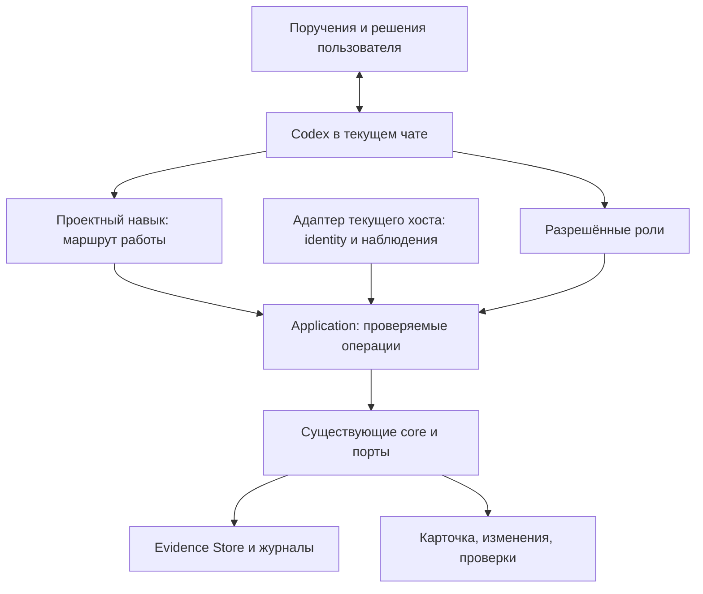

# ADR-0048: вести agent-workflow из текущего чата Codex через проектный навык

- **Status:** `accepted`
- **Date:** `2026-10-16`
- **Owner:** инструменты разработки и обвязка агентов
- **Decision basis:** [явное принятие пользователем ADR-0048 и разрешение CH1](../../exec-plans/completed/2026-10-16-agent-workflow-codex-chat.md#принятие-adr-0048-и-разрешение-ch1)

## Проблема

Пользователь ставит и ведёт задачи в чате Codex. Ручной запуск команды с JSON-заданием требует
переносить цель и решения из разговора, выбирать технические идентификаторы и обслуживать
состояние процесса. Это не соответствует желаемому способу работы.

В tools/agent-workflow уже есть подключение карточки, готовность исполнителя, машины выполнения
и приёмки, Evidence Store, координация и восстановление. Их сценарии вызываются программно;
CLI предоставляет инспекцию и подключение, но не связывает весь цикл с текущим чатом.
Отдельный квалифицированный сеанс App Server не доказывает доступ к активному сеансу приложения.

Нужен долговременный договор между разговором, текущим исполнителем и сохраняемым процессом:
кто определяет задачу, подтверждает полномочия, фиксирует переходы и продолжает незавершённую
работу. Одно описание навыка не обеспечивает проверку этих границ.

## Факторы и ограничения

- Пользователь запросил постановку и ведение задач через чат без ручных команд и JSON; текущее
  поручение разрешает только подготовку документов. Это предложение, а не принятое решение.
- [ADR-0047](0047-isolate-agent-workflow-in-tools.md) сохраняет границы core/application/ports/adapters,
  TypeScript, XState v5, один источник технического состояния и предметных владельцев проекта.
- Карточка ExecPlan владеет целью, критериями и проектным статусом. Evidence Store владеет
  техническими событиями, владением и доказательствами. Второй очереди задач не требуется.
- [Каталог процедур](../../../tools/agent-workflow/procedures/README.md) включает только явно
  выбранные задачи через preview/apply с внешними backup/receipt. Новая точка входа не выдаёт прав.
- [RunSpec и LOAD](../../../tools/agent-workflow/core/localRun.ts) требуют подтверждённых
  session/workspace/profile и фактического чтения. Requested не заменяет effective.
- [AppServerSessions](../../../tools/agent-workflow/adapters/codex/appServerSessions.ts) создаёт
  читающие сеансы и вызывает resume при inspect. Этот путь не подтверждён для привязки активного
  пишущего чата и не должен использоваться для неё без отдельной проверки.
- [DEC-06-B](../../quality/agent-workflow-contracts.md#принятый-dec-06-b) и действующая
  [квалификация](../../quality/agent-workflow-qualification.md) относятся к управляемым сеансам
  App Server. Видимость и передача активного сеанса приложения не гарантированы.
- Существующие правила советов, арбитража, аудита, обязательного validate, отмены и финализации
  сохраняются. Пропущенная обязательная роль не становится N/A, локальный тест не заменяет живую пробу.

## Рассмотренные варианты

- **Выбрано:** проектный навык направляет текущий Codex к существующим процедурам и коротким
  программным операциям; адаптер хоста подтверждает текущий сеанс и наблюдаемые действия.
  Пользователь управляет задачей обычными сообщениями.
- **Не выбрано:** пользователь запускает CLI и готовит JSON — переносит обслуживание процесса
  на пользователя и дублирует постановку из чата.
- **Не выбрано:** навык сам ведёт весь процесс только текстовыми отметками — не даёт проверки
  версий, допустимости переходов, повторов и владения существующими программными механизмами.
- **Не выбрано:** чат автоматически запускает отдельного главного исполнителя — меняет владельца
  работы и оставляет исходный чат посредником; не выполняет требование текущего исполнителя.
- **Не выбрано:** новый фоновый сервис, глобальный плагин или отдельный пакет заранее — необходимость
  и доступные возможности хоста ещё не подтверждены; увеличивает установку и эксплуатацию.

## Решение

### Статус и область предложения

Предлагается добавить режим ведения явно выбранной задачи из текущего чата Codex. До принятия,
реализации и квалификации режим не включается. Действующий управляемый App Server-маршрут
сохраняет прежние правила; новая квалификация не наследует его PASS автоматически.

### Пользовательский договор

Поручение обычным текстом с явным выбором agent-workflow подключает одну задачу в разрешённых
пределах. Продолжение обсуждения не требует повторного упоминания навыка. Агент извлекает цель,
границы и критерии, формирует технические параметры и использует одну карточку.

Новая задача получает сохранённый ID, существующая — сохраняет прежний. При неоднозначности
агент спрашивает, какую задачу продолжить; название чата и путь не заменяют identity.
Пользователь не обязан вводить ID, писать JSON, выполнять команды или заполнять журнал.
Обсуждение инструмента и поручение только на анализ не включают реализацию.

Сообщения о требованиях меняют соответствующую revision и применимость доказательств. Статус
показывает результат, открытые условия и ближайший шаг. Ответ человека связывается с конкретным
вопросом и версией задачи; старое согласие не разрешает другую операцию. Обычные технические
решения остаются у агента, действующие разрешения не запрашиваются повторно.

### Ответственности

Навык живёт в проекте и ссылается на процедуры; не копирует их правила и не заменяет навыки
анализа влияния, ADR и ревью. Его обнаружение проверяется в свежем чате.
Application собирает существующие сценарии и предоставляет короткие операции: чтение состояния,
намерение действия, запись доказательства, проверка перехода и проекция результата.
Транспорт этих операций выбирается по проверенным возможностям хоста. Внутренний CLI допустим,
но не является пользовательским интерфейсом и не требует ручного конфигурационного файла.

Core сохраняет чистые правила и существующие машины; новый сложный жизненный цикл также использует
XState v5. Адаптеры получают время, identity и наблюдения, работают с файлами/процессами и не
проникают в игровые пакеты. Не создавать монолитную вторую машину, копирующую все прежние переходы.

Текущий агент выполняет изменения привычными инструментами. Инструмент не посылает ему новый
ход во время активного хода и не ожидает ответа самому себе. Помощники запускаются в пределах
явного разрешения; их тип, профиль и изоляция подтверждаются отдельно. Главный исполнитель
не получает права координатора или нового сеанса только из-за выбора навыка.

### Привязка текущего чата

До READY адаптер обязан подтвердить реальную session identity, workspace, эффективный профиль
и наблюдаемое чтение точных версий правил. Собственный технический run ID инструмента отличать
от ID сеанса хоста. Не получать identity из заголовка, не считать отдельный App Server владельцем
активного чата приложения, не менять его настройки через инспекцию.

Отсутствие достоверного источника является незакрытым условием интеграции. Сначала определить
требуемую возможность и полномочия; скрытый запуск второго исполнителя не закрывает критерий.
Нельзя самовольно устанавливать плагин, включать hooks или изменять персональную конфигурацию.

### Подключение, выполнение и доказательства

Агент создаёт/выбирает карточку и использует существующий preview/apply с проверкой delta,
внешними backup и receipt. Подключение не равно готовности. Planning существенного изменения
выполняется в режиме чтения до READY пишущего исполнителя; принятое доказательство затем
используется существующим execution без повторного совета только ради запуска.

Фактический процесс проверки, exit code, журнал и существенные входы образуют evidence.
Ответ роли проверяется по структуре, identity, scope, источникам и ограничениям; текст PASS сам
по себе не подтверждает технический результат. Исходные FAIL, dissent и замечания сохраняются.
Изменение требований/входов отзывает затронутую приёмку. Result/DONE не выдаются при открытом
обязательном условии; конфликт проекции карточки не скрывается успешным итоговым сообщением.

Состояние операций хранится в прежнем Evidence Store с версиями и владением. Перед внешним
эффектом сохраняется намерение, затем подтверждение. Unknown сначала восстанавливается по
прежнему operation/session ID. Новый ID не является способом повторить неизвестное действие.

### Пауза, восстановление и передача

Предлагается различать паузу, прерывание хоста, отмену задачи и смену владельца. Пауза сохраняет
незавершённый scope и возможность продолжения; отмена сохраняет отдельный cancelled и не
возобновляется поздним ответом. Наличие паузы в этом предложении не означает, что новый статус
уже существует в LocalRun; его сохраняемый договор проектируется и проверяется до переключения.

Для нового режима восстановление того же подтверждённого сеанса после сжатия/прерывания
сохраняет владельца и сверяет checkpoint, входы и незавершённые операции. Оно не считается
relay и не наследует свидетельства создания/передачи из старого транспорта. Возможность
наблюдать события и продолжать в той же identity должна быть подтверждена живой пробой.

Смена исполнителя требует разрешённой передачи, подтверждённой остановки writers, release,
новой generation, adoption и наблюдаемого продолжения. Существующий fresh-session relay
управляемого App Server остаётся прежним. Применимость нового поведения к текущему чату
принимается явно как часть этого ADR, а не подразумевается из старой квалификации.
Истечение lease не доказывает остановку процессов. Если остановка/identity неизвестны,
зависимая работа остаётся открытой; новый пользовательский чат автоматически не создаётся.

Сохранение намерений не зависит от успешного завершения хода: аварийная остановка может не дать
агенту записать последний результат. Следующий ход выполняет сверку. Навык не обещает фонового
продолжения, уведомления или обработки событий после завершения хода без подтверждённого механизма.

### Совместимость и отключение

Мигрировать только явно выбранную задачу. Новый договор состояния версионировать отдельно;
старые readers, неизвестные версии, сохранение соседних полей, backup и rollback проверить
до записи рабочих данных. Не повышать все существующие схемы без конкретного изменения договора.

Отключение нового маршрута сохраняет AGENTS/PLANS, карточку и доказательства после прекращения
собственных writers. Откат подключения использует существующие проверки и не затирает поздние
правки. Done, finalization, archive и cleanup сохраняют разные полномочия; автоматическая
публикация, коммит/push и удаление данных в этот режим не входят.

## Обоснование

Текущий чат сохраняет контекст поручения и остаётся местом решений пользователя. Проектный навык
делает маршрут доступным обычному запросу. Программные операции используют уже реализованные
проверки, состояние и восстановление, сохраняя одного владельца каждого договора.
Первой проверяется интеграция с хостом, от которой зависит обещанный пользовательский результат.

## Последствия

- Пользователь управляет разработкой через разговор; техническое обслуживание выполняет агент.
- Сохраняются существующие правила, история замечаний и доказательства; повтор и продолжение
  используют подтверждённое состояние.
- Появляется зависимость от наблюдаемых возможностей текущего хоста и необходимость
  переквалификации при изменении клиента, модели, прав, событий или схем.
- Навык направляет поведение, но не является блокировкой произвольной записи. Владение и
  остановка требуют технических подтверждений; недоступная возможность остаётся ограничением.
- Новые связки требуют тестов и поддержки. Ускорение, экономия токенов и полная автономность
  после завершения хода не обещаются.

## Проверка

- Свежий чат: постановка без подготовленной карточки, продолжение без повторного вызова навыка,
  неоднозначная задача, информационный вопрос и read-only поручение.
- Подтверждение identity/profile/LOAD текущего агента без второго главного исполнителя и без
  изменения настроек активного сеанса. Неверный/неизвестный профиль блокирует готовность.
- Новая/существующая карточка, повтор подключения, disabled, ручной конфликт и неизвестная версия.
- Реальная проверка с FAIL, исправление и повторная приёмка тем же reviewer; изменения требований,
  частичный ответ, недоступная роль, арбитраж, native audit и разрешённая интеграция.
- Пауза/отмена, авария между эффектом и receipt, повтор, поздний ответ, два владельца, неизвестная
  остановка, восстановление той же identity и отдельно разрешённая передача.
- Профильные и процессные тесты, границы импортов, `yarn agent-workflow:test`, затем общий
  `yarn validate:brief` с четырьмя метриками 100% на окончательных входах.
- Живой сквозной сценарий из чата без ручных команд/JSON пользователя на зафиксированных
  версии клиента, профиле и правах. Локальные тесты, прошлый App Server PASS и принятие ADR
  не доказывают его выполнение; CI и внешняя публикация учитываются отдельно.

Порядок и критерии реализации принадлежат [ExecPlan](../../exec-plans/active/2026-10-16-agent-workflow-codex-chat.md).

## Связанные решения

- **Partially superseded by:** [ADR-0067](0067-run-reusable-agent-workflow-on-temporal.md) — текущий чат как обязательный технический исполнитель и владелец жизненного цикла новых задач после перехода.

- **Extended by:** [ADR-0068](0068-confirm-native-role-reads-from-bounded-parts.md) — наблюдаемое полное чтение крупных источников по проверяемым частям в native role-сеансах.

- **Extended by:** [ADR-0066](0066-await-workflow-events-in-current-turn.md) — ожидание значимых событий инструментом в текущем ходе без модельного опроса.
- **Extended by:** [ADR-0061](0061-load-workflow-procedures-by-action.md) — адресная загрузка процедур с сохранением legacy LOAD и допуска действий.

- **Extended by:** [ADR-0059](0059-separate-check-inputs-and-evidence-packages.md) — фиксированные входы проверок и отдельные пакеты доказательств.

- **Extended by:** [ADR-0050](0050-recover-workflow-owner-and-user-commands.md) — доставка подтверждённого пользовательского RESUME и единый путь продолжения.

- **Extends:** [ADR-0047](0047-isolate-agent-workflow-in-tools.md) — ведение явно выбранной задачи из текущего чата Codex через проектный навык и проверяемые операции.

- **Extended by:** [ADR-0049](0049-run-council-in-independent-read-only-sessions.md) — отдельные read-only сеансы совета текущего чата.

- **Partially superseded by:** [ADR-0063](0063-admit-local-implementation-with-executor-plan.md) — обязательный planning-совет для однозначной локальной реализации принятого договора.

## Условие пересмотра

Невозможность подтвердить identity/profile/чтение текущего чата, необходимость другого главного
исполнителя, несовместимость событий сжатия/остановки, повторная запись после передачи,
потеря замечаний или необходимость фонового сервиса требуют пересмотра соответствующей границы.
Смена транспорта или полномочий не выполняется как скрытый запасной маршрут. Второй реальный
проект и самостоятельный выпуск инструмента рассматриваются по ADR-0047 отдельно.
