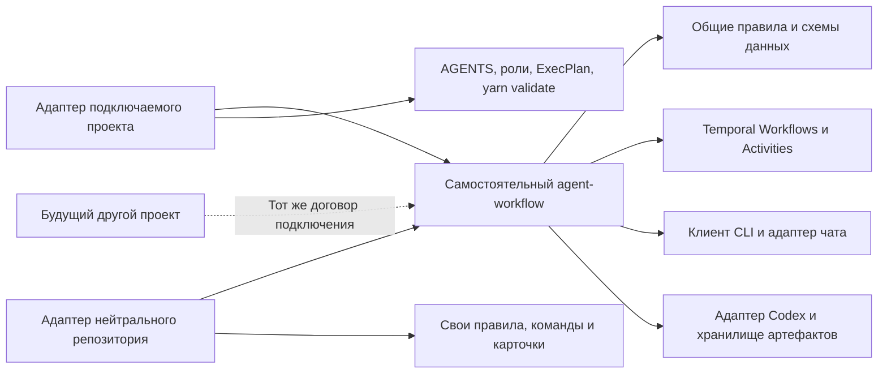

# Данные и подключение проектов Temporal

Договор данных, версий, поставки и карта потребителей. Это целевые обязанности инструмента;
их реализация и приёмка учитываются в [плане миграции](../exec-plans/active/2026-10-27-agent-workflow-temporal-migration.md).
[Сценарий и внешние действия](temporal-workflow.md) читаются при изменении соответствующей границы.

## Данные, история и версии

В историю Temporal передаются короткие предметные значения и ссылки на manifests, а не
полные журналы, изображения, diffs или копии всех ответов совета. Артефакты публикуются по
хешу с проверкой прав, пути и байтов; необходимый исходный FAIL сохраняется неизменным.
Индекс поиска восстанавливается из retained manifests и не принимает технических решений.
Это сохраняет назначение минимального хранения из ADR-0057/0058.

Continue-As-New переносит компактное актуальное состояние, незакрытые findings, редакции,
бюджет и защиту от повторных команд. Старые ответы не становятся новыми. Перед ним завершены
handlers и подтверждена судьба дочерних работ. Порог задаётся измерениями истории, а не
каждым модельным ответом. Основание — [Continue-As-New](https://docs.temporal.io/develop/typescript/workflows/continue-as-new).

Сроки хранения истории, доказательств, квитанций повторов и итоговых manifests задаются
отдельно. До завершения Workflow публикуется проверяемая запись завершения с taskId,
результатом и последней редакцией. Она сохраняет запрет повторного старта после истечения
retention Temporal; gateway проверяет её при новом запросе. Архив не удаляется автоматически
при DONE. Подробная история Temporal не подменяет долгосрочное хранение нужных доказательств.

Для восстановления нужны совместимые версии Workflow/Activity, Temporal persistence,
артефакты, локальные receipts эффектов и привязки рабочих машин. Отдельный manifest проекта
не восстанавливает активную историю Temporal. Потеря журнала эффектов при живом Codex даёт
unknown; восстановление из отстающей резервной копии требует сверки внешних эффектов.

Обновление выполняется версиями Workers и replay-проверками записанных историй; неизменяемая
сборка конкретной версии хранится до завершения её запусков. Нельзя исполнять долгую задачу
из постоянно меняющегося checkout инструмента. Worker Versioning и patching выбираются
по совместимости конкретного изменения. Основание — [версионирование](https://docs.temporal.io/develop/typescript/workflows/versioning).

### Конфигурация, обновления и Reset

Версия правил, профиль исполнения и параметры, определяющие ход задачи, входят в её
проверяемые входы: значения либо неизменяемая ссылка с хешем. Workflow получает их через
вход или результат Activity, сохранённый в истории; изменение конфигурационного файла
само по себе не меняет начатое исполнение. Отзыв прав, pause/cancel и новая редакция требований
остаются действующими командами. Сохранённая конфигурация и replay не заменяют свежую
проверку полномочий и актуальности перед внешним действием и принятием результата.

В T4 описать обновление Workers, в T5 проверить его по TEMP-11 на закреплённых SDK/Server:

1. Сохранить сборку и настройки прежней версии; новую проверить на
   [историях предыдущих версий](../testing/temporal-qualification.md#истории-предыдущих-версий-для-replay).
2. Явно задать, как новые задачи получают новую версию, а начатые продолжают совместимый
   код. Выбрать штатный Worker Versioning или patching для конкретного изменения;
   отдельный сервис флагов и собственный диспетчер версий не требуются.
3. При дефекте остановить назначение новых задач дефектной версии; вернуть маршрут новых
   задач на проверенную версию. Уже начатые не переключать на несовместимый код и не
   переносить в старый backend: сохранить диагностику и восстановить совместимое исполнение.
4. Удалять старый исполняющий Worker только после проверки отсутствия зависящих от него
   незавершённых запусков. Сборку сохранять также для историй и резервных копий, которым
   она нужна по принятым срокам хранения; окончание задачи не отменяет условия восстановления.

Административный Reset не откатывает изменения Git и отправленные запросы модели и не
доказывает остановку внешних исполнителей. В инструкции восстановления T4 описать сверку
живых процессов, прав, текущих файлов и квитанций до продолжения с выбранной точки истории.
Сохраняются task identity, логические operation IDs и защита от повторов вне откатываемой
истории; новый Temporal runId не разрешает повтор внешнего действия. При unknown сохраняется
пауза для сверки. Автоматический массовый Reset не входит в миграцию; это дополнение не
разрешает административную операцию. Пример восстановления в T5 использует прежнюю
матрицу отказов и проверяет отсутствие повторной записи или модельного старта.

### Диагностика ожиданий и ошибок

В T2/T3 пользовательский статус связывается с первичными данными; в T4 оформляется диагностика
эксплуатации, в T5 проверяется на соответствующих отказах. Причина ожидания отличается от
ошибки выполнения и содержит следующий допустимый шаг, без модельного опроса состояния.

| Ситуация | Что показывает клиент или эксплуатационная диагностика |
| --- | --- |
| Ожидание человека | Требуемое решение, редакция и зависимая область работы |
| Нет доступного Worker | Очередь/хост, время ожидания и известная причина; отсутствие данных обозначено явно |
| Повторяются технические ошибки | Операция, последняя ошибка, попытки и предел времени/повторов |
| Ошибка совместимости истории или выполнения Workflow Task | Версия Worker, затронутая задача и необходимость вмешательства; состояние не выдаётся за обычное ожидание |
| Неизвестный исход действия Codex | Логическая операция, известные session/turn IDs и требуемая сверка; новый ход не запускается |

Для связи журналов использовать project/task, Temporal run, версию Worker и operation ID,
где применимо. Использовать штатные журналы и метрики SDK с корректным поведением при replay,
не удваивая счётчики предметных действий. Ошибка воспроизведения должна быть заметна при
наблюдении стенда, а в постоянном режиме — через предусмотренный эксплуатационный канал.
Отдельная БД статусов, новый интерфейс мониторинга и полный комплекс сбора трассировок
не требуются без измеренной потребности. Основание —
[наблюдение в TypeScript SDK](https://docs.temporal.io/develop/typescript/platform/observability).

## Самостоятельный проект и подключение репозиториев

### Диаграмма 4. Повторное использование



Первый переносимый пакет готовится внутри `tools/agent-workflow`, чтобы не смешивать
архитектурную миграцию с публикацией. Будущая структура одного самостоятельного пакета:

```text
agent-workflow/
  package.json, lockfile, tsconfig, test configuration
  src/contracts/           # команды, результаты, версии и схемы
  src/policy/              # чистые правила допуска и приёмки
  src/workflows/           # Task, AgentAssignment, Finalization; функции совета
  src/activities/          # границы внешних действий
  src/adapters/codex/      # первый реальный агентный транспорт
  src/adapters/artifacts/  # файлы, manifests, receipts
  src/client/              # CLI и протокол клиента чата
  src/worker/              # сборка и запуск Workers
  examples/neutral/        # независимый исполняемый пример
  tests/, docs/, deploy/   # проверки, договоры и выбранное размещение
```

Каталоги `src`, самостоятельные package/lock/build/test, `examples` и `docs` созданы в T1.
Остальные пути и полная самостоятельная поставка ещё проверяются по этапам. Отдельные npm-пакеты на каждый каталог не создаются.
Границы импортов проверяются: policy/contracts без Temporal, Node и продукта;
workflows без Node/FS/Codex; activities через узкие порты; проектные правила не импортируются
общим кодом. Существующий код переносится по потребителю, без параллельного переписывания
всех модулей. После экспорта этот репозиторий использует закреплённую версию пакета,
а не хранит вторую изменяемую копию движка.

Архитектурная проверка запрещает новым штатным Activities импортировать старые
`application/*Workflow`, сохраняющие собственные переходы, reservations или lifecycle-журналы.
Переиспользуются чистые правила и узкие транспортные, файловые и доказательные адаптеры.
Целевая поставка поддерживает хранение и восстановление данных Temporal. Сопровождение
форматов Legacy исключено по [ADR-0075](decisions/0075-exclude-legacy-from-temporal-delivery.md).

Версионированный descriptor проекта задаёт projectId, логический workspace, источники правил,
ролевые профили/триггеры, необходимые команды проверок и адаптер карточки. Абсолютный путь
на конкретной машине находится в локальной регистрации Worker. Секреты и исполняемый код
в descriptor не передаются. Команды разрешаются доверенным локальным реестром в executable/args,
без shell-интерполяции текста задачи. Требование этой игры `yarn validate` и четыре метрики
100% сохраняются в её профиле, а не навязываются всем будущим проектам.

В коде уже есть границы, но переносимость неполна: `core/projectInspection.ts` предполагает
Node и `yarn validate`; `Connection` фиксирует набор процедур и каталоги планов;
`harness2/pilot.py` обращается к `apps/player` и `packages`. Их потребители включены в карту
ниже. Проектные знания выносятся в адаптер, а не заменяются параметрами во всех функциях.

Готовность к отдельному проекту подтверждается самостоятельной установкой, сборкой и
проверками из копии пакета при запрещённом доступе к исходному репозиторию. Второй тестовый
проект имеет другие команды, пути карточек и ролевые правила. Это доказательство переносимости,
а не выдуманный второй промышленный потребитель. Создание внешнего репозитория, лицензия
собственного пакета и публичный выпуск остаются отдельным будущим действием пользователя.

## Карта потребителей перед миграцией

Все пути ниже относительно корня репозитория. Перед правкой конкретного договора исполнитель
уточняет через `rg` вызовы, readers/writers, тесты и экспорты; таблица задаёт начальные владельцы.

| Старый владелец / договор | Производители и потребители | Целевая правка | Доказательство |
| --- | --- | --- | --- |
| Lifecycle и готовность | `core/localRun.ts`, `core/execution.ts`, `application/currentChatWorkflow.ts`, `application/executionWorkflow.ts`, `cli/chatRuntime.ts` | TaskWorkflow; чистые guards; клиент команд | `execution`, `chatRuntime`, `chatHost`, `localPlanning` + новые replay-тесты |
| Советы и применимость | `core/council.ts`, `application/chatCouncil.ts`, `cli/taskChatCouncil.ts`, `taskChatSelection.ts`, `refreshCouncilInputs.ts`, `roles/` | Функции совета в TaskWorkflow, AgentAssignment Workflows; selection/reuse из policy | `council`, `nativeCouncil`, `councilProfiles`, changed-input и исходный FAIL |
| Доставка и LOAD | `application/dataRoutes.ts`, `ports/agentSessions.ts`, `adapters/codex/appServerSessions.ts`, `transportJournal.ts`, `nativeRead.ts`, `currentChatHost.ts` | Activities, прежняя идентичность и минимальный журнал эффектов | Потерянные create/send, повтор, неверный LOAD/profile, неизвестная версия |
| Ожидание и продолжение | `cli/councilProgress.ts`, `councilWaitGuard.ts`, `chatContinuation.ts`, `adapters/codex/appServerTransport.ts`, `ports/councilWait.ts` | Temporal timers/messages; наблюдение App Server внутри Activity | Потеря completion, закрытие клиента, restart, cancel, stale revision |
| Полномочия и команды | `core/chatControl.ts`, `chatMessages.ts`, `application/chatControl.ts`, `chatMessages.ts`, `adapters/codex/userCommands.ts` | Подтверждённые команды клиента и последовательный reducer Workflow | Дубликат/конфликт commandId, чужой автор, устаревшая редакция |
| Пишущие исполнители и передача | `application/coderWorkflow.ts`, `coordinationWorkflow.ts`, `relayWorkflow.ts`, соответствующие `ports/`, `adapters/codex/writerProcesses.ts`, `adapters/project/coderWorkspaces.ts` | Child Workflows; изоляция; защита интеграции и остановки | `coder`, `relayWriters`, `relayOwnership`, конкуренция и offline host |
| Хранение состояния и evidence | `ports/evidenceStore.ts`, `ports/*Journal.ts`, `adapters/storage/storeDatabase.ts`, `workflowJournal.ts`, `localRunStores.ts`, `coordinationJournal.ts`, `relayJournal.ts` | Temporal — состояние задач; артефакты — первичные доказательства | Проверка ID/hash; сверка pending/unknown и восстановление в Temporal |
| Архив, финализация, backup | `application/finalizationWorkflow.ts`, `adapters/storage/finalization*`, `storeBackup.ts`, `retentionMaintenance.ts`, `sharedArtifacts.ts`, `retainedBlobs.ts` | FinalizationWorkflow; независимые retention/backup по владельцам | `finalization*`, `restoredDependencies`, неполный экспорт и stale backup |
| Карточки и подключение | `core/connection.ts`, `projectInspection.ts`, `taskConnection.ts`, `application/projectLocalCard.ts`, `adapters/project/*Connection.ts`, `fileProjectCards.ts` | Версионированный descriptor/ProjectAdapter; проекция с конфликтами | Нейтральный проект, чужая правка карточки, schema mismatch |
| CLI, навык и зависимости | `cli/main.ts`, `runAgentWorkflow.ts`, `chatCommand.ts`, `.agents/skills/agent-workflow/`, `package.json`, архитектурные тесты | CLI-клиент Temporal для новых задач; самостоятельный пакет | Штатный запуск, краткий статус, отказ пишущим входам Legacy после переключения |
| Стоимость и вспомогательные клиенты | `comparison/`, `cli/comparisonSeries.ts`, `comparisonReport.ts`, `adapters/codex/comparisonUsage.ts`, `harness2/` | Один стенд двух реализаций для T5; новые модельные запуски Harness² исключить из штатной поставки, читатели отчётов сохранить | Отказ исключённому запуску до model RPC; не двойной модельный запуск; совместимость отчётов; полный учёт |
| Документация и gates | `tools/agent-workflow/*.md`, `procedures/`, `docs/quality/agent-workflow-contracts.md`, профиль/traceability, ADR и `.agents/README.md` | Описать фактический новый путь на этапе включения | Ссылки, обнаружимость, обычный/граничный/неприменимый случай |

Неизвестные потребители: внешние копии CLI/descriptor, локальные подключённые Store на других
машинах и самостоятельные скрипты. До общего переключения нужен инвентарный отчёт без
сканирования чужих каталогов. Неизвестный потребитель не получает молча новый формат.

### Ранний разбор упрощения

Использовать карту выше для TEMP-16–18 уже на завершении читающего T2 и первого полного B1
в T3. Первые сквозные измерения B1 предусмотрены планом; уточнение добавляет к их разбору
состав собственного кода, не отдельный модельный эксперимент или новый порог допуска.

Для пройденного маршрута записать в его доказательствах: старый механизм и потребители →
замена в Temporal/Codex → оставшаяся наша обязанность → проверка сохранённой гарантии →
условие удаления. Перед удалением из штатной поставки сверять оставшихся потребителей и
применимые критерии T6. Использовать существующую карту потребителей.

Разбирать механизмы по одному: сначала использовать штатную возможность платформы, затем
переиспользовать чистое правило или узкий адаптер; новый механизм писать только для оставшейся
обязанности с названным потребителем. В текущем срезе `ReaderWorkflow`/`ReviewWorkflow`
показывают сценарий, `readerSession`/`recoveredSend` — специфику транспорта,
`observedLoad`/`readerBoundary`/`effects` — проверяемые внешние границы. Их принадлежность
каталогу не является основанием ни сохранить всё, ни удалить всё.

Перед переносом следующих маршрутов T3 применить выводы первого B1: убрать обнаруженное
дублирование, уточнить общий адаптер или зафиксировать обоснованную внешнюю обязанность.
Большой адаптер не означает автоматически неудачу Temporal: отдельно оценивать транспорт
Codex, проверки доказательств и собственно управление процессом. Не повторять уже пригодные
прогоны ради таблицы; недостающие наблюдения помечать неизвестными. Необходимость изменить
гарантии, архитектуру или бюджет возвращается пользователю, а не маскируется упрощением.
Все маршруты T3 и итоговое сравнение T5 сохраняются.
