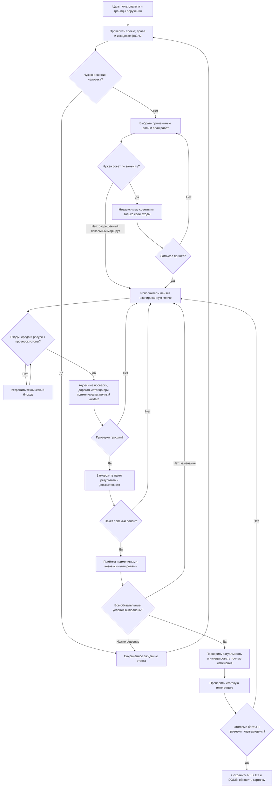
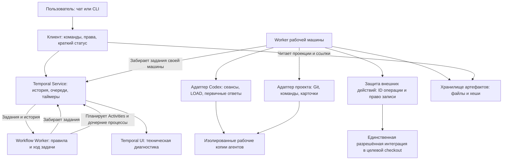
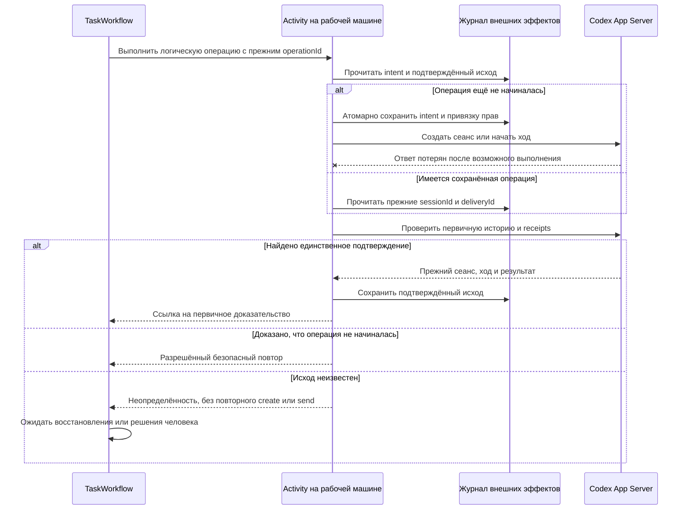

# Договор целевого процесса Temporal

Здесь находятся постоянные условия сценария, границы владения и внешних действий.
Открытые критерии, ближайшие шаги и приёмка принадлежат [плану миграции](../exec-plans/active/2026-10-27-agent-workflow-temporal-migration.md).
Описание целевого состояния не включает T6 и не подтверждает живую квалификацию.

## Минимальный собственный код

Цель упрощения — оставить предметные правила, сценарий их применения и необходимые внешние
границы. Правила, влияющие на допуск действия, остаются исполняемыми проверками; инструкции
для модели не заменяют проверку полномочий, открытого FAIL, актуальности входов или остановки.

| Ответственность | Реализация в целевой системе | Что не строить повторно |
| --- | --- | --- |
| Роли, findings, reuse, критерии готовности | Наши чистые policy/contracts и проектный адаптер | Независимо поддерживаемую копию правил в промптах или отдельном реестре |
| Порядок реализации, проверок, приёмки и интеграции | Наш сценарий в Temporal Workflow | Параллельный контроллер тех же стадий в Activity |
| Сохранение хода, очереди, ожидания и технические повторы | Temporal | Собственный движок checkpoint, таймеров и продления технического lease |
| Диалог агента, запросы модели и инструменты | Готовый Codex-исполнитель за узким адаптером | Собственный агентный цикл или второй исполнитель без реального потребителя |
| Полномочия, LOAD/answer binding, Git, stop и внешние эффекты | Наши проверяемые адаптеры и минимальные квитанции | Дублирование технического состояния задачи в журнале эффектов |

Сценарий Workflow остаётся нашим кодом: Temporal исполняет заданный процесс, но не выбирает
правила разработки. Codex снимает необходимость создавать агентный цикл, но не доказывает
предметную приёмку. Удалять проверку только потому, что действие завершилось в SDK, нельзя.

Pi Durable, собственный интерфейс диалогов и общий многопользовательский сервис не добавляются
к текущей миграции. Подписка как способ доступа к модели сама по себе не обосновывает смену
исполнителя. Если измерения покажут конкретное ограничение Codex, отдельное предложение
сопоставляет заменяемый код с новой ответственностью за инструменты, изоляцию, остановку,
хранилище сеансов и обновления. Смена принятой границы оформляется по правилам ADR;
такая будущая возможность не требует сейчас универсального слоя провайдеров или серии Pi.

Доступ с телефона через интернет для одного пользователя и одного Mac ведётся отдельным
[планом расширения](../exec-plans/active/2026-11-22-agent-workflow-mobile-control.md):
просмотр статуса, ответ на ожидающий вопрос, затем постановка задачи. Он не расширяет TEMP-критерии и не является условием завершения
миграции; подготовка его плана не разрешает реализацию или открытие сетевого доступа.

## Система глазами пользователя

Пользователь создаёт задачу, видит следующий шаг и причины ожидания, уточняет требования
и принимает решения. Закрытие чата не стирает задачу. После запуска разрешённого фонового
исполнения Workers могут продолжать техническую работу в пределах выданного поручения.
Новое решение человека останавливает соответствующую ветвь до ответа.

Temporal UI показывает шаги, попытки, ожидания и ошибки. Чат/CLI показывает предметный
статус: что сделано, какой результат принят, что мешает продолжению и какие доказательства
это подтверждают. Уведомление в чат — возможность клиентского адаптера; его доступность
проверяется отдельно. Возобновление модельного хода интерфейса не обещается автоматически.

### Диаграмма 1. Путь задачи

Возврат на исправление сохраняет исходный FAIL. Неизменные принятые части переиспользуются;
изменившиеся зависимости открывают только затронутые проверки и роли. Изменение требований
создаёт новую редакцию и возвращает затронутые решения к планированию. Каждая петля имеет
согласованный бюджет; его исчерпание приводит к ожиданию решения, а не бесконечной работе.

### Измеримые условия экономного выполнения

В T2/T3 проверить EFF-02/03/06/07/10 из
[сохранённых требований эффективности](../exec-plans/active/2026-10-27-agent-workflow-temporal-migration.md#открытые-требования-эффективности) на новом пути.
Для локального исправления сохраняется таблица «роль → изменившаяся зависимость → новый
LOAD/send либо reuse → причина». Неизменные принятые роли не получают нового модельного
хода; общий договор, открытый FAIL и неизвестная полнота зависимостей открывают нужные
проверки. Байты предметных входов и реальные токены измеряются отдельно; произвольного
лимита файлов или обязательных ролей нет.

До зависимых дорогих действий проверяются обязательные входы, среда, доступные ресурсы
и полнота пакета. Отсутствующий обязательный вход даёт ноль запусков зависимых советников;
непройденная подготовка — ноль запусков зависимой дорогой матрицы; неполный пакет — ноль
запусков итоговой приёмки. Исправимый технический отказ возвращается на подготовку;
решение человека требуется только при изменении полномочий, бюджета или иных согласованных
границ. Проектные команды и порядок принадлежат ProjectAdapter. Обязательный полный
validate на окончательных байтах сохраняется; новая сводка не инвалидирует неизменный прогон.

## Целевая архитектура и границы владения

Исходный срез анализа: `HEAD 88cf212060bc7abb54b286426f7be361524d2c6b`, 2026-10-27.
В рабочем дереве есть изменения игры другого исполнителя; они не входят в этот план.
Инструмент запускается из корневого `package.json`, использует TS/XState, локальный SQLite,
App Server и файловые адаптеры. Корневой `.agents/workflow.json` в этом срезе отсутствует:
подключения и Store нужно инвентаризировать по реальным передаваемым дескрипторам,
не считать предложенный путь доказательством включения. Версии и состояние перед реализацией
сверяются заново; этот срез не является новым PASS текущего рабочего дерева.

### Диаграмма 2. Где находится код и кто чем управляет

Workflow Worker выполняет детерминированный TypeScript. Он не читает репозиторий,
не запускает процесс и не обращается к сети напрямую. Такие действия — Activities.
Workers запускают наш код; Temporal не исполняет произвольный репозиторий вместо них.
Основание — [ограничения Workflow](https://docs.temporal.io/develop/typescript/workflows/basics)
и [устройство Worker](https://docs.temporal.io/develop/typescript/workers/run-worker-process).

| Данные / решение | Единственный владелец в целевой системе | Что не должно стать вторым владельцем |
| --- | --- | --- |
| Цель, критерии и решения пользователя | Версионированная карточка проекта; принятая редакция закреплена в Workflow | Текст случайного сообщения агента |
| Текущее техническое состояние, шаги, роли, ожидания, бюджет, применимость результатов | Состояние TaskWorkflow, восстанавливаемое Temporal | Старый SQLite checkpoint, JSON progress, независимо меняемый статус CLI |
| Очереди, попытки Activity, таймеры, доставка между Workflows | Temporal | Свой планировщик, цикл модельного опроса или параллельный журнал выполнения |
| Полномочия внешнего действия | Подтверждённое поручение + актуальная редакция/поколение; проверка на границе Worker | Наличие workflowId, task token либо имени очереди |
| Первичный результат Codex, Git и команды | Наблюдение соответствующего адаптера с квитанцией | Успешное завершение Activity без содержательной проверки |
| Неизменяемые доказательства и необходимые исходные FAIL | Хранилище артефактов по хешу и итоговый manifest | Полные тела в каждом событии Temporal |
| Неопределённый внешний эффект, привязка session/turn, запрет повторной записи | Минимальный локальный журнал эффектов на рабочей машине | Дублирование фаз задачи и решений совета в этом журнале |
| Поиск завершённых доказательств и отображаемая карточка | Восстанавливаемые проекции закреплённых manifests | Новый независимо редактируемый технический Store |

Карточка остаётся источником цели; её техническая сводка — проекция. Ручная смена цели
принимается явной командой с новой редакцией. Изменение карточки во время операции вызывает
конфликт, а не перезапись. Два хранилища не обновляются как будто общей транзакцией:
артефакт публикуется до принятия ссылки; результат Workflow и последующая проекция связаны
стабильным ID операции. Неуспешная проекция остаётся pending и восстанавливается.

### Что переносится, удаляется и сохраняется

| Нынешний механизм | Целевой механизм | Условие удаления прежнего кода |
| --- | --- | --- |
| `localRun` / `execution` как движок стадий и его persistence | TaskWorkflow и предметные проверки переходов | Эквивалентные положительные и отрицательные сценарии |
| `coordination` и технический цикл совета | Функции TaskWorkflow, Child Workflows самостоятельных поручений, Activities и сбор результатов | Нет самостоятельного второго планировщика |
| `councilProgress`, wait-файлы, собственные таймеры | Signals/Updates, Workflow timers, ожидание результата | Потеря/дубли событий и перезапуск квалифицированы |
| CAS, lease и журналы вокруг технического checkpoint, включая восстановление срока из ADR-0050 | История и последовательная обработка команд TaskWorkflow | Все производители переведены; гарантии восстановления и доставки RESUME сохранены; не касается защиты внешнего checkout |
| Технический retry/recovery, reservation стадии | Политики Activity, Workflow replay, явное состояние неопределённости | Повтор внешнего эффекта защищён у адаптера |
| SQLite Evidence Store как владелец текущего состояния | Temporal для новых задач; отдельные неизменяемые артефакты и поисковая проекция | Проверены восстановление Temporal и сохранность его артефактов |
| Relay как перенос контроллера после сжатия чата | Workflow продолжает существовать; новый сеанс агента получает проверяемый пакет | Смена сеанса не передаёт автоматически права записи |
| `finalization` как собственный технический журнал | Отдельный Workflow финализации | Сохранены разные полномочия DONE, archive и cleanup |
| Политики ролей, findings, reuse, LOAD/answer binding, manifests | Чистые функции и типы, вызываемые из Workflow/Activities | Смысл сохраняется; удаляется только дублирование |
| App Server RPC, первичные receipts, Git и process-stop | Activities и адаптеры | Их внешняя семантика не предоставляется Temporal |

XState не переносится механически как второй движок того же процесса. Чистые полезные
проверки переиспользуются; технические машины, повторяющие lifecycle Temporal, удаляются.
Для предметной машины с самостоятельным потребителем XState допустим, но без второго
сохраняемого состояния. Исключение из текущего архитектурного правила оформляется ADR-0067.

### Когда нужен отдельный Workflow

Совет по умолчанию — функция TaskWorkflow: выбрать роли, запустить самостоятельные
поручения, собрать и проверить результаты. CouncilWorkflow выделяется только при
самостоятельном управлении, отдельном сроке жизни либо измеренной необходимости ограничить
историю. Каталог кода сам по себе не является основанием. AgentAssignmentWorkflow владеет
поручением, сеансом, областью работы и подтверждаемой остановкой.

Фиксация RESULT/DONE и публикация итогового manifest принадлежат TaskWorkflow. Длительная
финализация имеет отдельные полномочия и может исполняться независимым Workflow после
соответствующего разрешения; завершение задачи не ждёт будущего archive/cleanup.
Не создавать связь parent/child, требующую ждать этой очистки для завершения TaskWorkflow.
Основание выбора границ — [назначение Child Workflows](https://docs.temporal.io/child-workflows#when-to-use-child-workflows).

## Договор Workflow и внешних действий

### Идентификаторы и команды

- Один TaskWorkflow на пару `projectId/taskId`; кодирование ключа без коллизий.
  Повтор старта с тем же назначением присоединяется к существующему выполнению,
  с другим содержимым — конфликтует. Политики Workflow ID задаются явно и тестируются.
- `Temporal runId`, `taskId`, ID модельного сеанса и `ownerGeneration` — разные сущности.
  Continue-As-New, retry Activity и смена версии Worker не создают нового поручения.
- Внешний `operationId` выводится из логического действия, редакции, роли/области и номера
  явно разрешённой попытки; не из Activity attempt или Temporal runId.
- Команды содержат `commandId`, хеш содержания, ожидаемую редакцию, подтверждённого автора
  и scope. Изменения состояния последовательно применяет один обработчик команд.
  Асинхронные Signal/Update handlers не меняют общее состояние через конкурирующие `await`.
  Сериализуется только короткое применение команды; ожидание модели, проверки или другой
  длительной Activity не удерживает эту блокировку. Пауза, отмена и новая редакция требований
  принимаются во время работы; подтверждение команды не подменяет квитанцию остановки.
- Query читает состояние. Update принимает команду и возвращает подтверждённый результат.
  Signal сообщает о внешнем событии; событие лишь повод проверить первичный источник.
  Получение сообщения не означает принятия PASS или новых полномочий.
- Версия требований, отмена, права и актуальные файлы проверяются перед каждым зависимым
  внешним действием и перед применением результата. Результат старой проверки из replay
  не является свежим разрешением. Проверка и запись в checkout защищаются одной границей.

Основание — [сообщения Temporal](https://docs.temporal.io/develop/typescript/workflows/message-passing).
Конкретные названия команд и JSON Schema фиксируются в T0a, до создания потребителей.

### Частичная замена ADR-0050

В T0a применить принятую [область замены и сохраняемые гарантии](decisions/inherited/0067-run-reusable-agent-workflow-on-temporal.md#восстановление-прежнего-владельца-и-доставка-команд)
[ADR-0050](decisions/inherited/0050-recover-workflow-owner-and-user-commands.md): только
эксклюзивную блокировку контроллера, CAS-восстановление и программное продление технического
lease заменяют состояние TaskWorkflow и последовательная обработка команд.

Восстановление сохраняет прежние owner/generation, identity и scope; входы, workspace,
terminal boundaries и незавершённые операции проверяются до продолжения. Unknown,
незавершённый прежний ход, frozen/released, другой владелец/generation или подмена workspace
запрещают восстановление. Перерыв, replay и перезапуск Worker не передают права записи.

Доставленный RESUME сохраняет нативно подтверждённый пользовательский источник, точные
project/task/логический run/target, generation и редакции управления/требований. Повтор с
прежними ID/hash возвращает прежний результат; иной payload или получатель требует отдельного
допуска. Команда разрешает только продолжение прежнего scope, без смены владельца, отмены,
публикации или расширения прав. Действительное прежнее поручение не запрашивается повторно
из-за перерыва или повторной доставки. До проверенного перехода новых задач прежний
механизм ADR-0050 остаётся обязательным; для ранее начатых задач — до их завершения.

### Диаграмма 3. Потерянный ответ и безопасное восстановление

Activities допускают повторы; однократность внешнего эффекта остаётся обязанностью адаптера.
Heartbeat сообщает о жизни Activity и может переносить checkpoint, но не заменяет журнал
эффектов: процесс может упасть между запуском Codex и heartbeat. Неизвестное создание
сеанса без восстанавливаемой identity не лечится новым `thread/start`.
Основание — [Activities](https://docs.temporal.io/activities) и
[heartbeat/cancellation](https://docs.temporal.io/develop/typescript/activities/timeouts).

Журнал эффектов хранит только operationId/hash запроса, привязку к project/task/workspace
и поколению полномочий, известные session/turn IDs, intent, подтверждённый исход либо unknown
и ссылки на квитанции. Повтор ID атомарно сверяет содержание. Журнал не выбирает следующий
шаг, не назначает повторы и таймеры, не хранит решения совета. Он применяется к внешним
действиям, чей исход нельзя безопасно восстановить из Temporal; копия каждой Activity не нужна.

Ошибки разделяются: временная доступность; подтверждённый отказ без эффекта; неизвестный
исход; нарушение договора/устаревший вход; предметный FAIL. Только первые два вида допускают
программный повтор по соответствующему договору. FAIL возвращается как результат проверки,
а не маскируется успешным retry. Для каждого типа Activity заданы пределы времени/попыток
и поведение при исчерпании; дорогие модельные вызовы имеют дополнительный общий бюджет.

### Исполнители, файлы и остановка

Управляемый сеанс Codex живёт за Worker рабочей машины. Длительная Activity наблюдает его,
поддерживает канал App Server и heartbeat; после сбоя сначала восстанавливает прежний сеанс.
Внешнее завершение Activity можно использовать только при реальном независимом наблюдателе;
возврат из функции сам по себе не сохраняет процесс и соединение.

В T0b до соответствующего запуска задать профиль параллельности моделей, тяжёлых проверок
и служебных операций, учитывая все Workers и подключённые проекты одного хоста. Пределы
выбираются по ресурсам и измерениям; лимит одного Worker не считается общим лимитом машины.
Использовать штатные очереди и настройки ёмкости Temporal, не добавлять свой планировщик стадий.
Остановка и сверка исхода остаются доступны при занятых длительными работами местах:
через наблюдающую Activity либо отдельно обеспеченную ёмкость служебных операций.
Если stop выполняется отдельной Activity, она не ждёт завершения модели ради свободного места.
Основание — [настройка ёмкости Workers](https://docs.temporal.io/develop/worker-performance/runtime-tuning).

Пишущие агенты работают в изолированных копиях. Общий checkout меняет только операция
интеграции через локальную защиту с монотонным поколением и актуальными хешами. Параллельная
Activity на другом Worker не получает права на тот же checkout. Имя очереди задаёт маршрут,
но не полномочия; Worker сверяет project/workspace/grant. Разделение недоверенных проектов
обеспечивают учётные данные, права и изоляция процессов, а не префикс taskId.

Отмена задачи — отдельная команда: запрет новых действий, запрос остановки детей,
проверка собственных процессов, сохранение receipts, затем `cancelled`. Бюджет/пауза
останавливают новые модельные действия и следуют заранее принятой политике уже начатых.
Нет связи с машиной — нет подтверждения остановки и права переназначить её пишущий scope.
Остальные независимые области могут продолжаться. Административный terminate Temporal
не является штатной отменой и не разрешает освобождение внешнего ресурса.

Child Workflow получает явную Parent Close Policy. Родитель ожидает подтверждённого
завершения/остановки детей; Continue-As-New выполняется на безопасной границе без потерянных
детей и незавершённых обработчиков сообщений. Не полагаться на настройки по умолчанию.
Основание — [Child Workflows](https://docs.temporal.io/develop/typescript/workflows/child-workflows).
