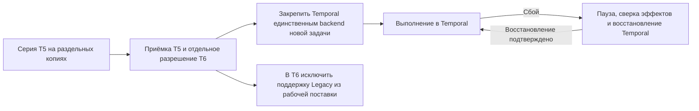

# Размещение, переключение и восстановление Temporal

Условия размещения и перехода между backend. Профиль запуска и полномочия определяются
[условиями T0b](exec-plans/active/2026-10-27-agent-workflow-temporal-migration.md#t0b-условия-перед-зависимыми-действиями);
актуальная приёмка — [сводкой плана](exec-plans/active/2026-10-27-agent-workflow-temporal-migration.md#сводка-для-продолжения).
По [ADR-0073](design/decisions/0073-complete-document-extraction-without-runtime-compatibility.md)
сохранение исполнения старого runtime не является условием документного переноса.
Описанный ниже порядок T6 не означает включения T6 или разрешения запусков.

## Профиль размещения

Первый обязательный профиль — один доверенный владелец, один постоянный хост исполнения
macOS и несколько подключаемых проектов. На нём размещаются Workers, рабочие копии
и файловое хранилище артефактов; для восстановления резервируются все три границы данных.
Артефакт имеет логический ID и проверяемое разрешение в root проекта, а не произвольный
абсолютный путь из сообщения. Переносимость на другой проект не выдаётся за поддержку
другой ОС или автоматический перенос активного процесса между компьютерами.
Общий сервер с исполнением на нескольких хостах потребует доступного им artifact adapter
и отдельной квалификации транспорта; его реализация не является условием этого плана.
Host/workspace IDs в договорах нужны уже сейчас для отказа при неверном маршруте.

Рекомендуемый эталон: самостоятельно размещённый Temporal с PostgreSQL и Workers на рабочих
машинах; разработка/CI используют отдельный тестовый сервер. Это сохраняет контроль над
данными и не требует платной учётной записи. Temporal Cloud остаётся вариантом размещения
того же кода; разработка собственного backend вместо Temporal не предусматривается.
SQLite dev server не выдаётся за подтверждённое постоянное размещение.
Основание — [развёртывание](https://docs.temporal.io/self-hosted-guide/deployment) и
[граница embedded server](https://docs.temporal.io/self-hosted-guide/embedded-server).

Архитектура размещения принята; конкретные эксплуатационные значения и полномочия
определяются по [таблице T0b](exec-plans/active/2026-10-27-agent-workflow-temporal-migration.md#t0b-условия-перед-зависимыми-действиями). Их отсутствие не запрещает независимую реализацию T1.
Принятие ADR само по себе не устанавливает сервисы, не выдаёт новые права/секреты
и не запускает платные проверки. Первоначальное принятие ограничивалось документами;
дополнительные разрешения реализации записаны в [сводке плана](exec-plans/active/2026-10-27-agent-workflow-temporal-migration.md#сводка-для-продолжения).

Смена текущего чата на клиент процесса — намеренная целевая граница: техническим ходом
управляет Workflow, реализацию выполняет управляемый Codex-сеанс Worker. Пользовательский
чат остаётся местом постановки и решений. Самостоятельный перехват уже открытого чата,
его архивация ради освобождения канала и изменение внутренних файлов Codex запрещены.

## Переключение и восстановление

### Нужно ли переносить активные задачи

Нет. [Пользователь в текущем чате](codex://threads/01a17d9e-3a80-7103-bf63-25bd1dbdbfda)
2026-10-27 явно принял правило: «Через Temporal начинать только новые задачи.
Это проще: не нужно переносить незавершённое исполнение».

По подтверждению пользователя от 2026-11-18 незавершённых задач Legacy нет. После T5 новые
задачи запускаются в Temporal. Переход не требует поддержки исполнения Legacy, переноса
истории или проверки старого архива. Исходные доказательства каждой попытки сохраняются.
Сбой Temporal устраняется в Temporal. [Границы поставки](design/decisions/0075-exclude-legacy-from-temporal-delivery.md).

### Диаграмма 5. Переключение на Temporal

1. После T5 и отдельного разрешения включить Temporal для новых задач. До первого внешнего
   действия для project/task атомарно закрепляется единственный backend. Зарегистрированное
   назначение защищает от повторного запуска поручения, в том числе под другим taskId.
   Неизвестная принадлежность блокирует старт.
2. После переключения пишущие входы Legacy отвергают запуск и изменение рабочих задач до
   внешнего эффекта.
3. Сравнительные прогоны T5 используют изолированные копии и общую защиту интеграции.
   Новая запись в занятый scope ждёт подтверждённого освобождения. Истечение времени
   не доказывает остановку.
4. При сбое Temporal запретить новые действия, сверить внешние эффекты и восстановить тот же
   backend с совместимой версией и резервной копией. Unknown сохраняет паузу. Пересоздание
   этой задачи в старом runtime или восстановление старой БД поверх новых фактов запрещены;
   недоступность Temporal не включает автоматический приём новых задач старым движком.
5. В T6 после проверки входов и состава пакета исключить поддержку Legacy из штатной поставки.
   Очистка исходных Store требует отдельного разрешения.
